<!-- ═══════════════ HEADER ═══════════════ -->
<h1 align="center">
<a href="https://github.com/aepasahan"><picture><source media="(prefers-color-scheme: dark)" srcset="./assets/btn-follow-dark.svg" /></picture></a>
<a href="https://aepasahan.com"></a>
Ahmet Erkan Paşahan
</h1>

<!-- ═══════════════ INTRO ═══════════════ -->
<p align="center">
<b>Hi 👋, I'm Ahmet Erkan — a full-stack engineer &amp; product designer based in Istanbul.</b><br />
For 8+ years I've been creating scalable digital systems, captivating experiences and modern web applications,
working at the intersection of elegant UI design and robust software engineering.
</p>

<br />

<!-- ═══════════════ EXPERIENCE ═══════════════ -->
## 💼 Currently

<p align="center">
<a href="https://aepasahan.com/about"><picture><source media="(prefers-color-scheme: dark)" srcset="./assets/cards/exp-aepasahan-dev-dark.svg" />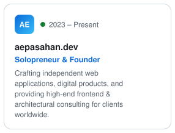</picture></a>
<a href="https://aepasahan.com/about"><picture><source media="(prefers-color-scheme: dark)" srcset="./assets/cards/exp-basevare-dark.svg" />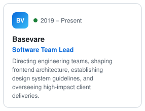</picture></a>
<a href="https://aepasahan.com/about"><picture><source media="(prefers-color-scheme: dark)" srcset="./assets/cards/exp-creetivelab-dark.svg" />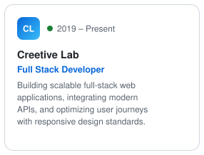</picture></a>
</p>

<p align="center">
<b>Previously</b><br />
UI/UX Designer at Webgen Design <i>(2018 – 2021)</i> · Front End Developer at Webgen Design <i>(2016 – 2018)</i><br />
Front End Developer at Pixeg <i>(2016)</i>
</p>

<br />

<!-- ═══════════════ PROJECTS ═══════════════ -->
## 🚀 Selected Works

<p align="center">
<a href="https://aepasahan.com/projects"><picture><source media="(prefers-color-scheme: dark)" srcset="./assets/cards/proj-flexful-colors-dark.svg" />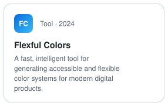</picture></a>
<a href="https://aepasahan.com/projects"><picture><source media="(prefers-color-scheme: dark)" srcset="./assets/cards/proj-ts-auto-import-organizer-dark.svg" />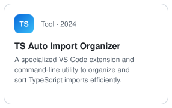</picture></a>
<a href="https://aepasahan.com/projects"><picture><source media="(prefers-color-scheme: dark)" srcset="./assets/cards/proj-reentaly-dark.svg" />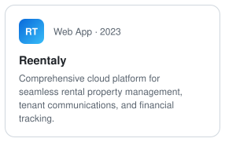</picture></a>
<a href="https://aepasahan.com/projects"><picture><source media="(prefers-color-scheme: dark)" srcset="./assets/cards/proj-project-l-veni-vidi-legi-dark.svg" />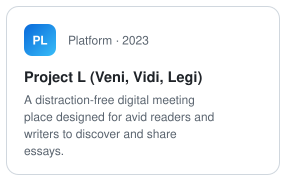</picture></a>
<a href="https://aepasahan.com/projects"><picture><source media="(prefers-color-scheme: dark)" srcset="./assets/cards/proj-ims-education-automation-dark.svg" />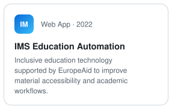</picture></a>
<a href="https://aepasahan.com/projects"><picture><source media="(prefers-color-scheme: dark)" srcset="./assets/cards/proj-rehabox-dark.svg" />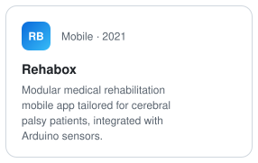</picture></a>
<a href="https://aepasahan.com/projects"><picture><source media="(prefers-color-scheme: dark)" srcset="./assets/cards/proj-covid-breathe-dark.svg" />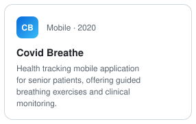</picture></a>
<a href="https://aepasahan.com/projects"><picture><source media="(prefers-color-scheme: dark)" srcset="./assets/cards/proj-passlist-dark.svg" />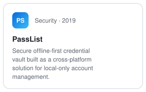</picture></a>
<a href="https://aepasahan.com/projects"><picture><source media="(prefers-color-scheme: dark)" srcset="./assets/cards/proj-servicy-follow-dark.svg" />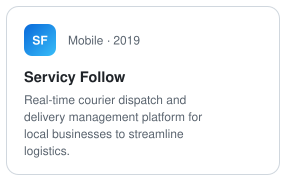</picture></a>
</p>

<p align="center">
<a href="https://aepasahan.com/projects"></a>
</p>

<br />

<!-- ═══════════════ MEET ME IN YOUR TERMINAL ═══════════════ -->
## ⌨️ Meet me in your terminal

<p align="center">
<a href="https://www.npmjs.com/package/aepasahan"><picture><source media="(prefers-color-scheme: dark)" srcset="./assets/terminal-dark.svg" /></picture></a>
</p>

<p align="center">A small interactive business card. Run it, use the arrow keys and press enter.<br />No install or sign-up needed — <code>npx</code> comes with Node.js.</p>

```bash
npx aepasahan
```

<br />

<!-- ═══════════════ FOOTER ═══════════════ -->
<hr />

<p>
<a href="https://maps.google.com/?q=Istanbul,Türkiye"><picture><source media="(prefers-color-scheme: dark)" srcset="./assets/location-dark.svg" /></picture></a>
<a href="mailto:aepasahan.dev@gmail.com"><picture><source media="(prefers-color-scheme: dark)" srcset="./assets/social-gmail-dark.svg" /></picture></a>
<a href="https://instagram.com/aepasahan.dev"><picture><source media="(prefers-color-scheme: dark)" srcset="./assets/social-instagram-dark.svg" /></picture></a>
<a href="https://linkedin.com/in/aepasahan"><picture><source media="(prefers-color-scheme: dark)" srcset="./assets/social-linkedin-dark.svg" /></picture></a>
<a href="https://x.com/aepasahan_dev"><picture><source media="(prefers-color-scheme: dark)" srcset="./assets/social-x-dark.svg" /></picture></a>
</p>
