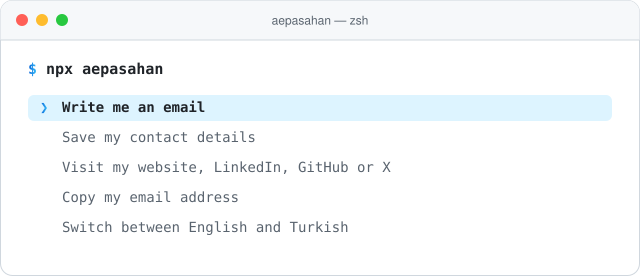

<!-- ═══════════════ HEADER ═══════════════ -->
<h1 align="center">
<a href="https://github.com/aepasahan"><picture><source media="(prefers-color-scheme: dark)" srcset="./assets/btn-follow-dark.svg" /></picture></a>
<a href="https://aepasahan.com"></a>
Ahmet Erkan Paşahan
</h1>

<!-- ═══════════════ INTRO ═══════════════ -->
<p align="center">
<b>Hi 👋, I'm Ahmet Erkan — a Full Stack Developer based in Istanbul.</b><br />
I build web products end to end, from the interface down to the API, and I currently work at
<a href="https://github.com/creetivelab">Creetive Lab</a>.
</p>

<br />

<!-- ═══════════════ MEET ME IN YOUR TERMINAL ═══════════════ -->
## ⌨️ Meet me in your terminal

<p align="center">
<a href="https://www.npmjs.com/package/aepasahan"><picture><source media="(prefers-color-scheme: dark)" srcset="./assets/terminal-dark.svg" /></picture></a>
</p>

<p align="center">A small interactive business card. Run it, use the arrow keys and press enter.<br />No install or sign-up needed — <code>npx</code> comes with Node.js.</p>

```bash
npx aepasahan
```

<br />

<!-- ═══════════════ FOOTER ═══════════════ -->
<hr />

<p>
<a href="https://maps.google.com/?q=Istanbul,Türkiye"><picture><source media="(prefers-color-scheme: dark)" srcset="./assets/location-dark.svg" /></picture></a>
<a href="mailto:aepasahan.dev@gmail.com"><picture><source media="(prefers-color-scheme: dark)" srcset="./assets/social-gmail-dark.svg" /></picture></a>
<a href="https://instagram.com/aepasahan.dev"><picture><source media="(prefers-color-scheme: dark)" srcset="./assets/social-instagram-dark.svg" /></picture></a>
<a href="https://linkedin.com/in/aepasahan"><picture><source media="(prefers-color-scheme: dark)" srcset="./assets/social-linkedin-dark.svg" /></picture></a>
<a href="https://x.com/aepasahan_dev"><picture><source media="(prefers-color-scheme: dark)" srcset="./assets/social-x-dark.svg" /></picture></a>
</p>
